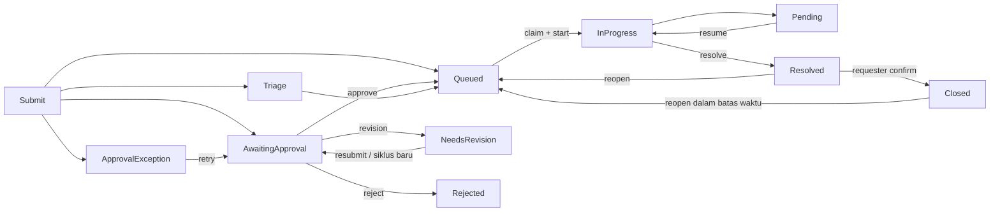

# IT Request — Penyelesaian Fase 3

Tanggal: 28 Oktober 2026. Status: **implementasi dan migrasi Docker local selesai**. Acuan: [PLAN_IT_REQUEST_ITIL.md](PLAN_IT_REQUEST_ITIL.md), Fase 3. Pengajuan untuk pengguna tetap tertutup sampai SLA dan pilot melewati gerbang rilis Fase 4–5.

## Hasil implementasi

| Area | Perilaku yang tersedia |
| --- | --- |
| Submit | Incident/Service Request mengikuti katalog aktif; jenis catatan, layanan, kategori dan template ditentukan server. UUID submission token menahan duplikasi; token dengan isi/aktor berbeda ditolak. |
| Snapshot | Tiket menyimpan versi konfigurasi terpublikasi, form, jawaban, klasifikasi, matriks prioritas, routing dan kebijakan approval melalui referensi ke bundle immutable. Pergantian versi aktif tidak mengubah tiket existing. |
| Routing | Aturan pertama yang cocok berdasarkan katalog/layanan/kategori/jenis catatan dipakai. Tim tidak tersedia beralih ke fallback layanan; fallback tidak tersedia masuk triage dengan alasan. |
| Triage & prioritas | Koordinator menentukan tim, impact dan urgency dengan alasan; prioritas diturunkan dari sembilan kombinasi matriks versi tiket. |
| Penugasan | Claim, penetapan PIC, transfer, dan pencabutan assignment saat transfer. Tim/PIC harus aktif dan memenuhi akses. |
| Tugas | Tugas wajib/opsional, pelaksana tim, hasil penyelesaian, pengalihan tugas setelah transfer. Tugas wajib terbuka menghalangi resolve. |
| Penanganan | Start, pending dengan alasan/jadwal pembaruan, resume, resolve dengan keterangan, konfirmasi requester, cancel dan reopen dalam jendela konfigurasi. |
| Approval | Aturan Service Request berurutan, atasan melalui resolver Portal atau approver tertentu. Kegagalan resolver/self-approval masuk exception; koordinator dapat retry. Revisi membuat siklus approval baru pada snapshot yang sama. |
| Privasi | Komentar internal, lampiran privat, klasifikasi rahasia per katalog dan perubahan kerahasiaan beralasan. Approver memakai tampilan terbatas untuk keputusan. |
| Audit & notifikasi | Setiap perubahan memiliki aktor, urutan, status sebelum/sesudah dan alasan. Inbox IT personal tersimpan atomik dengan event dan unik per event/penerima; akses diperiksa kembali saat membaca. |
| Web & mobile | Antrean, detail, form, tindak lanjut, persetujuan, lampiran dan inbox memakai domain service yang sama. API mobile menggunakan bearer token existing; parameter role dari klien tidak memberi hak. |
| Tim IT | Superadmin konfigurasi dapat membuat tim draft, mengaktifkan tim dan mengatur anggota teknisi/koordinator. Perubahan tim memakai fingerprint untuk konflik edit dan audit sebelum/sesudah. |

## Konfigurasi workflow

Bundle schema 1 dari Fase 2 tetap terbaca. Pada draft, tab **Workflow** menyediakan upgrade ke schema 2 dengan profil `it_v1`. Field form dan master existing tetap dipertahankan.

Profil schema 2 memuat routing/approval berurutan, matriks prioritas dan batas reopen 1–30 hari. `sla=phase4_pending` dan `submission_enabled=false` tetap dilindungi. Publikasi workflow memerlukan owner serta fallback aktif dengan anggota untuk setiap layanan aktif. Menyimpan draft yang belum lengkap tetap diperbolehkan.

Langkah persiapan konfigurasi operasional:

1. Konfigurasi IT → Tim IT: tetapkan anggota dan koordinator sesuai keputusan organisasi; aktifkan tim.
2. Tetapkan owner dan fallback pada layanan; tinjau status aktif katalog serta klasifikasi tiket rahasia, terutama laporan keamanan.
3. Pada draft, buka Workflow dan tambahkan profil, routing, approval, matriks prioritas dan batas reopen.
4. Simpan dengan alasan, periksa preview, kemudian publikasikan setelah siap. Publikasi tidak membuka pengajuan.
5. Lanjutkan kalender, SLA/escalation dan monitoring pada Fase 4; pembukaan layanan mengikuti pilot Fase 5.

Pengelola konfigurasi tidak otomatis menjadi petugas atau pembaca global tiket. Keanggotaan tim merupakan pemberian akses operasional yang disengaja dan tercatat. Kemampuan operator lintas tim `manage_it_operations`, baca antrean `view_it_queue`, dan baca rahasia `view_restricted_it` tetap terpisah. Bootstrap capability oleh operator memakai perintah existing `satset:it-capability` dengan alasan; tidak ada capability operasional yang diberikan otomatis.

## Status dan pengaman

Cancel oleh requester tersedia sebelum penanganan dimulai, termasuk saat approval/revisi/exception. Reopen memakai jendela waktu snapshot. Tidak ada auto-close atau pemrosesan SLA pada Fase 3.

Mutasi mengunci baris request lalu detail dalam transaksi, memeriksa `lock_version` dan transisi, serta menulis event bernomor unik. Keputusan mengunci request/detail/approval dan memeriksa siklus aktif sehingga approval lama tidak dapat digunakan kembali. Claim yang kalah dan keputusan kedua mendapat HTTP 409.

Requester dapat mengonfirmasi/menolak hasil melalui reopen, tetapi teknisi tidak dapat menutup atas nama requester. Koordinator tidak dapat melewati approval dengan triage atau transfer. Hilangnya anggota tim mencabut akses workflow, termasuk apabila assignment lama masih tercatat. Tiket lama tanpa `catalog_key`/snapshot tetap mode baca sampai ada keputusan adopsi eksplisit.

Lampiran berada pada disk `it_private` di `storage/app/private/it-attachments`, tidak pada public storage. Unduhan memeriksa tiket dan visibilitas internal, dengan respons attachment dan `nosniff`. File gagal transaksi dibersihkan. Revisi mempertahankan bukti yang diperlukan dan memakai kumpulan file terbaru per field/siklus, sambil mempertahankan file lama sebagai bukti historis.

Inbox hanya memberi pesan umum dan tautan berotorisasi; tindakan internal tidak dikirim kepada requester. Tidak ada broadcast IT kepada GA atau semua admin. Retry worker, monitoring dan inbox operasional SLA/major tersedia pada Fase 4. Push/email eksternal memerlukan verifikasi provider/kanal saat pilot; lihat IT_REQUEST_PHASE_4.md.

## Endpoint

Web: `/it`, `/it/create`, `/it/tickets/{ticket}`, `/it/approvals`, `/it/notifications`, `/it/configuration/teams`.

Mobile: prefix `/api/mobile/v1/satset/it`.

| Metode / path mobile | Fungsi |
| --- | --- |
| `GET /catalog` | Katalog requester, mengikuti feature flag |
| `POST /form` | Schema requester dan conditional fields, bukan bundle admin |
| `GET /tickets` | Daftar berotorisasi; filter `scope`, `status`, `q` |
| `POST /tickets` | Submit multipart/JSON |
| `GET /tickets/{ticket}` | Detail dengan proyeksi visibilitas server |
| `POST /tickets/{ticket}/form` | Form revisi dari snapshot milik requester |
| `POST /tickets/{ticket}/actions/{action}` | Mutasi dengan `lock_version`; role diputuskan server |
| `GET /tickets/{ticket}/attachments/{attachment}` | Unduhan privat |
| `GET /approvals`, `GET /approvals/{approval}` | Daftar dan tampilan approver terbatas |
| `POST /approvals/{approval}/decision` | `approved`, `rejected`, `revision` dengan alasan dan versi |
| `GET /notifications`, `POST /notifications/{notification}/read` | Inbox personal IT |

Submit memerlukan `submission_token` UUID, `catalog_key`, `title`, `description`, `impact`, `urgency`, dan `answers` sesuai template. `configuration_version_id` dari form dapat dikirim untuk mendeteksi pergantian versi saat mengisi. Upload form memakai `uploads[field_key][]`; lampiran tindak lanjut memakai `uploads[attachments][]` dan `is_internal`. Field `file` tidak menerima metadata/path dari klien.

Endpoint mobile lama tetap dilindungi untuk IT; integrasi workflow menggunakan namespace `/it` di atas. Endpoint lama tidak dapat dipakai untuk memutasi workflow baru.

## Verifikasi

- **151 test / 735 assertions lulus**, mencakup regresi GA dan 24 test workflow IT.
- **21 pemeriksaan MySQL lulus** pada hasil restore terpisah, termasuk empat contoh layanan sampai closed, reopen, bearer token, proyeksi approver dan snapshot.
- Claim dan approval benar-benar dijalankan oleh **dua proses PHP dengan koneksi MySQL terpisah**: masing-masing menghasilkan satu HTTP 200 dan satu HTTP 409, dengan satu event keputusan/claim.
- Bukti file privat, komentar internal, self-approval, resolver offline/retry, revisi berulang dengan lampiran wajib, transfer tugas, pencabutan anggota, kerahasiaan katalog dan stale form telah diuji.
- Halaman antrean IT dan konfigurasi diperiksa melalui Chrome local. Form runtime dan layar peran diuji melalui HTTP test; pengajuan source tetap tertutup.
- Pemeriksaan sintaks JavaScript dan `git diff --check` lulus.

## Backup, penerapan dan kondisi local

Backup akhir: `storage/app/private/it-phase01/baseline-20261028T093319Z/`. Database dan file privat, izin direktori 0700/file 0600. Uji restore ke `satset_it_verify_20261028093346` memverifikasi **55 tabel / 7 file**. Fixture uji di salinan telah dibersihkan; hash seluruh tabel original cocok kecuali registry migrasi/sesi yang memang dikecualikan dari perbandingan penerapan.

Migrasi `2026_10_28_000004_create_it_workflow` menambah kolom detail dan tujuh tabel IT. Penerapan local mempertahankan **53 tabel original di luar migrations/sessions** beserta kolom existing yang dibandingkan. Tidak ada seed bisnis atau publikasi pada source. Drift pada draft v3 terdeteksi sebelum penerapan; backup dibuat ulang untuk melindungi perubahan pengguna. Inventaris snapshot juga diperbaiki agar terbatas pada schema database yang dipilih ketika beberapa database verifikasi ada.

Bukti privat di folder backup: `restore-verification.json`, `phase03-mysql-verification.json`, `phase03-deployment.json`.

Kondisi setelah penerapan:

- Jumlah request tetap **15**; tiket runtime baru pada source **0**.
- Draft v1/v2/v3 dipertahankan; versi aktif masih **null**.
- Tiga tim tetap nonaktif, belum ada anggota. Penetapan petugas nyata belum dilakukan.
- ID 1 dan 31 tetap hanya memiliki `manage_it_configuration` dan `publish_it_configuration`.
- `satset.it.requests_enabled=false`; tabel workflow baru kosong.
- Pemeriksaan baca saja dapat dijalankan melalui `scripts/it_phase03_status.php` di container app.

## Lanjutan Fase 4

Bangun kalender dan target SLA berversi, clock respons/pemulihan/pemenuhan, pause/resume, breach, eskalasi, antrean jatuh tempo, major incident minimum serta worker/scheduler dengan rekonsiliasi. Baru setelah pengujian tersebut dan pilot Fase 5, pengajuan untuk pengguna dibuka.
